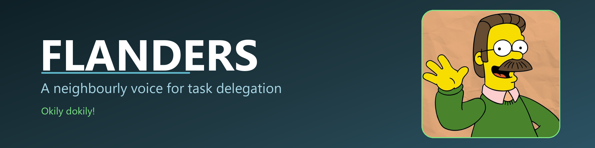
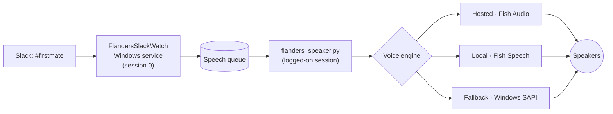

<p align="center">
  
</p>

<p align="center">
  
  
  
  
  
</p>

# Flanders

Hi-diddly-ho! This here is a task assistant with the voice of Springfield's
friendliest neighbour and the manners to match. It reads a Slack channel out
loud, keeps the personality in the delivery, and stays plain about the facts — no
dressing up a failure as a success, and no hollering about routine progress.

Okily dokily. Aw, hamburgers, one honest note before the tour: the voice is a
clone of a public character sample, put to work here for a personal assistant. It
is not affiliated with, or endorsed by, anybody official.

---

## 🎙️ What it does

- **Speaks any text handed to it**, through the best voice it can find.
- **Watches a Slack channel** and reads new messages aloud.
- **Cleans Slack text first**, so emoji codes and markup never come out as
  "colon wave colon".
- **Keeps quiet on noise** — acknowledgements and command help are skipped,
  because "great!" does not need a public announcement.
- **Runs as a Windows service** — no console window, no supervisor script, and it
  restarts itself if it trips.

## 🧩 The pieces

| Module | What it does |
|---|---|
| `flanders/voice_integration.py` | Picks the voice engine and owns the `/flanders` command tree |
| `flanders/fish_audio_tts.py` | Hosted Fish Audio voice, free tier |
| `flanders/flanders_local_tts.py` | Offline Fish Speech clone on the local GPU |
| `flanders/flanders_speech.py` | Turns Slack text into speakable prose |
| `flanders/flanders_audio.py` | Plays audio on a chosen output device |
| `flanders/flanders_character.py` | Personality and task classification |
| `flanders/slack_bridge.py` | Reads and posts to the Slack channel |
| `flanders/flanders_service.py` | The Windows service that owns the listener |
| `flanders/flanders_speaker.py` | The in-session speaker the service drives |
| `flanders/flanders_say.py` | The command-line bridge firstmate calls to speak text |

## 🛠️ How a message becomes speech



Windows keeps services on a separate desktop with no audio endpoint, so a service
can read Slack all day and still never make a sound. That is why the work is
split in two: **the service listens**, and a small companion in the logged-on
session **does the talking**. The service starts that companion itself and keeps
it alive.

## 🎚️ The voice ladder

Three engines, with one rule about where each is allowed:

| Order | Engine | Used by |
|---|---|---|
| 1 | **Hosted** — Fish Audio `s2.1-pro-free` | Interactive sessions, when a session key is supplied |
| 2 | **Local** — Fish Speech 1.5 | Background Slack speech, and any session without a key |
| 3 | **Fallback** — Windows SAPI | When the local model is not installed |

Background speech is deliberately offline. The service never holds a key and
never reaches a secret store, so spoken Slack messages always use the local
voice, even if a key happens to be present in the environment.

## 📋 Requirements

| Need | When | Notes |
|---|---|---|
| Windows 10 or 11 | always | the service, the SAPI fallback, and the win32 calls are Windows-only |
| Python 3.12 | always | everything runs in the project virtual environment |
| `requirements.txt` | always | audio playback, the speech fallback, and the service host |
| A Fish Audio key | hosted voice | the free model needs a key but no credit; without a key the local voice takes over |
| An NVIDIA GPU | offline voice | only for the local Fish Speech model |
| A Slack app | the listener | bot token with read and write scopes |
| firstmate | optional | the Slack listener reads its config by default |

### 🤝 How firstmate fits

Flanders does not import firstmate, and the voice, the character, and the
`/flanders` command tree all run without it. The relationship runs in two
directions:

1. **firstmate calls Flanders.** Its `/flanders` skill runs
   `flanders/flanders_say.py` to speak a reply.
2. **The Slack listener reads firstmate's config by default.** `slack_bridge.py`
   resolves `config/slack.env` in this order: `--config <path>`, then
   `$FM_HOME/config/slack.env`, then `../firstmate/config/slack.env`.

So firstmate is the default neighbour, not a hard dependency: any file with the
right keys works, and `--config` overrides everything.

### 💬 The Slack app

The listener needs a Slack app installed in the workspace. Its bot token needs:

| Scope | Why |
|---|---|
| `channels:history` or `groups:history` | read the channel |
| `chat:write` | post replies |
| `users:read` *(optional)* | speak real names instead of "a teammate" |

`config/slack.env` holds the keys:

```
SLACK_BOT_TOKEN=xoxb-...
SLACK_CHANNEL_ID=C...
SLACK_OWNER_USER_ID=U...
SLACK_WATCHDOG_URL=        # optional health ping
```

## ⚡ Quick start

```powershell
python -m venv .venv
.\.venv\Scripts\python.exe -m pip install -r requirements.txt
.\.venv\Scripts\python.exe flanders\voice_integration.py
```

The offline voice needs one extra pass to fetch the model and the reference
sample:

```powershell
powershell -ExecutionPolicy Bypass -File scripts\setup_local.ps1
```

Much obliged to [`docs/LOCAL_VOICE.md`](docs/LOCAL_VOICE.md) for the details.

## 🗣️ The command tree

```
/flanders delegate <task>   classify the work and speak the guidance
/flanders help              the guide
/flanders modes             delivery modes and merge posture
/flanders status            the task on the desk
/flanders quit              leave
```

Plain text is read aloud but never answered, and never turned into a task. Only
the commands above actually do something.

## ✅ Tests

Automated checks, safe to run anywhere:

```powershell
.\.venv\Scripts\python.exe tests\test_speech.py
.\.venv\Scripts\python.exe tests\test_commands.py
```

The audible checks live in `tests/manual/`, because they play sound and need the
local model or a network key:

```powershell
.\.venv\Scripts\python.exe tests\manual\test_local_voice.py
```

## 🗂️ Project layout

```
flanders/     the package: voice, speech, Slack, and the Windows service
docs/         guides: local voice, service, and the agent skill
scripts/      setup and operations (venv, model, API key, service install)
tools/        diagnostics: audio devices, voice probe, benchmarks
tests/        automated checks; tests/manual/ holds the audible ones
references/   voice-clone transcript
```

The package runs directly (`python flanders\voice_integration.py`) or as a module
(`python -m flanders.voice_integration`).

## 📚 Documentation

- [`docs/LOCAL_VOICE.md`](docs/LOCAL_VOICE.md) — offline model, tuning, and cost notes
- [`docs/SERVICE.md`](docs/SERVICE.md) — the service, and why there are two processes
- [`docs/SKILL.md`](docs/SKILL.md) — how firstmate drives the character

## 🔐 Credentials

No credentials live in this repository, and the application writes none to disk.
The hosted voice reads its key from the environment for the length of one
session:

```powershell
$env:FISH_API_KEY = "<the-key>"
```

The key exists only inside that process tree. It is never written to a file, and
the Proton vault is read only with explicit consent — never automatically.

When no key is present, the local voice takes over. The free model still requires
a key: an unauthenticated request is rejected. It does **not** require API
credit — the model is chosen with the `model` header, and omitting that header is
the only thing that falls back to a paid model and reports insufficient credit.

## ⚖️ A note on the voice

The voice is a clone of a public character sample, used for a personal assistant.
No affiliation with, or endorsement by, the rights holders is claimed or implied.

---

<p align="center"><em>Okily dokily! Much obliged for reading.</em></p>
